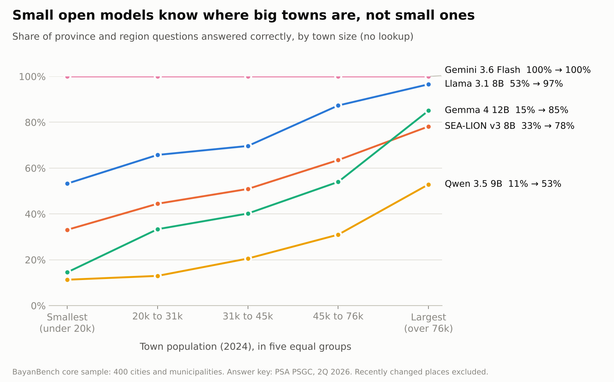
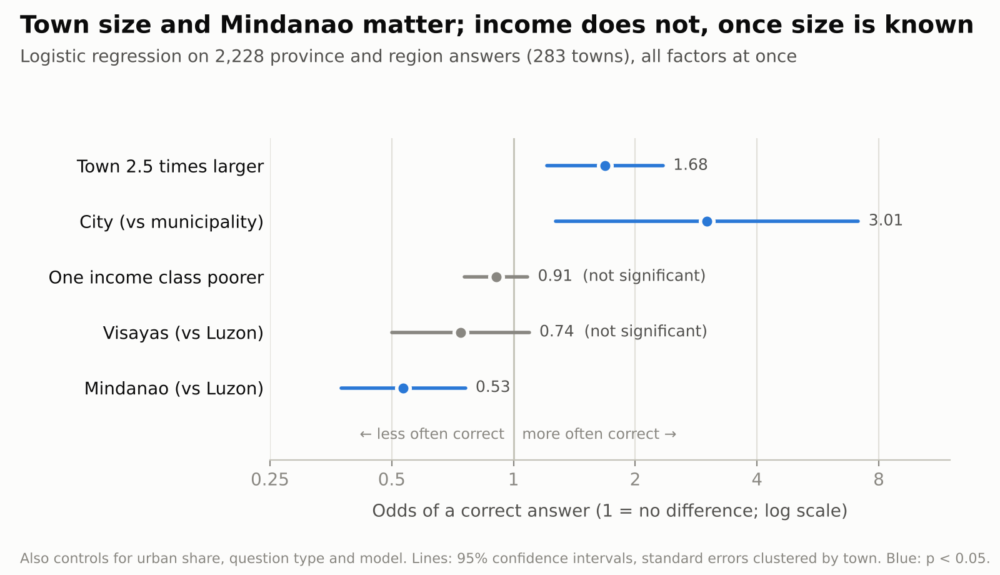
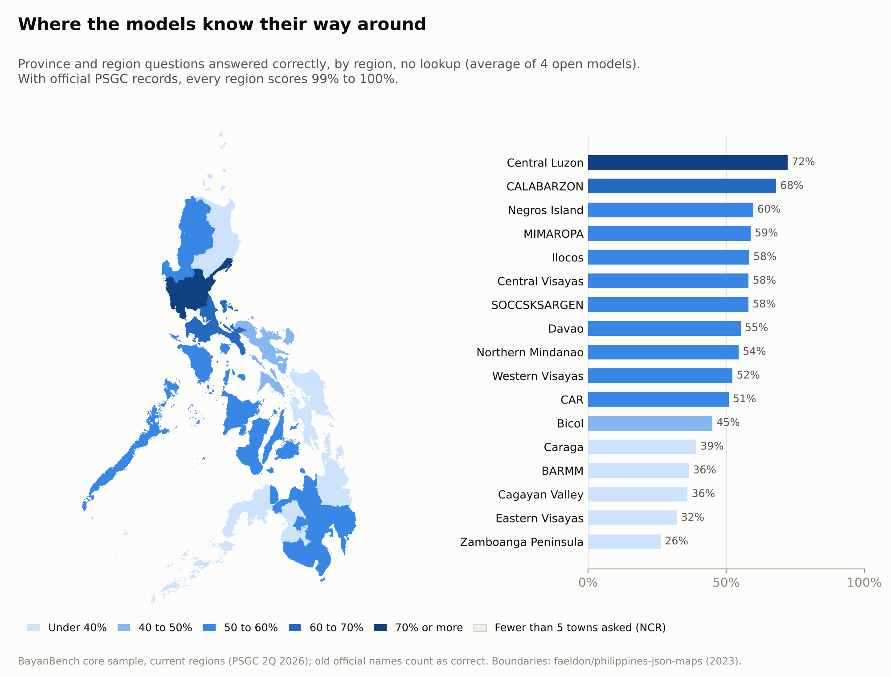
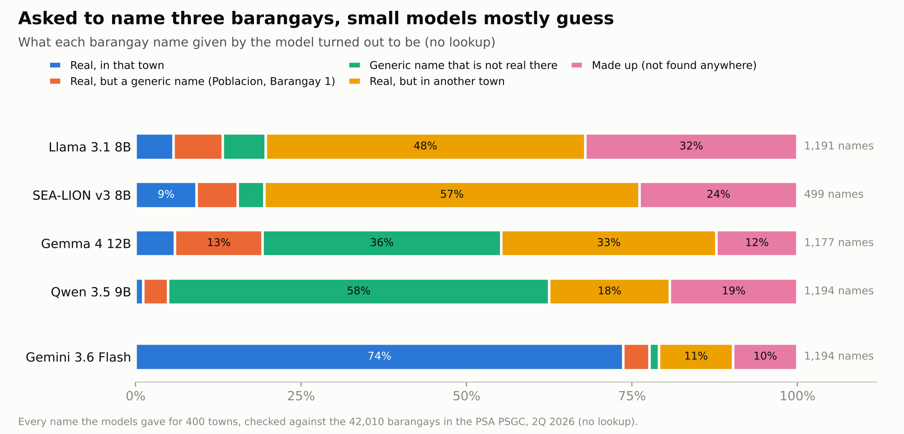
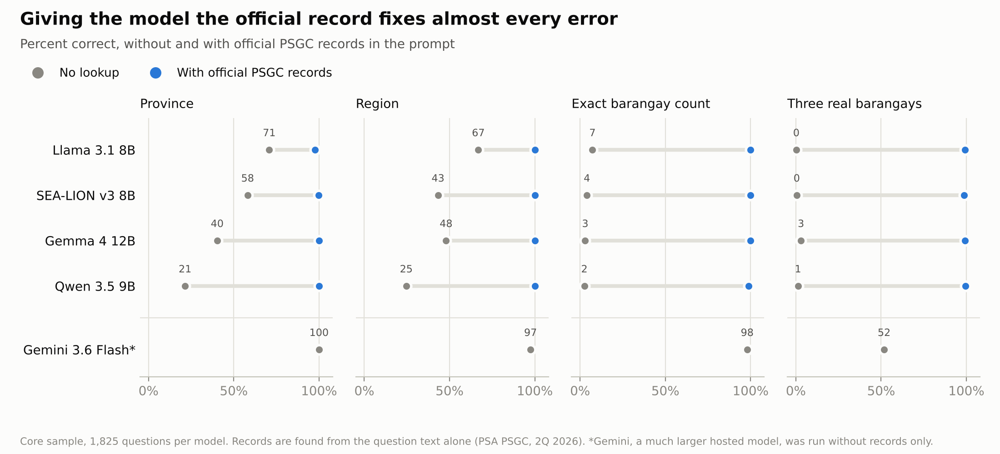

# BayanBench: Does AI Know Your Town?

An audit of how well AI language models know Philippine cities, municipalities, and barangays, whether smaller and more remote towns receive less accurate answers, and whether a simple lookup of official government data fixes the gap.



## Key findings

1. **Small open models do not know small towns.** Asked which province or region a town belongs to, the four open models answered correctly for 53 to 97 percent of the largest towns but only 11 to 53 percent of the smallest towns.
2. **Town size and Mindanao matter; income does not, once size is known.** In a logistic regression with all factors at once (2,228 answers, 283 towns, standard errors clustered by town), a town 2.5 times larger had 1.68 times the odds of a correct answer (95% CI 1.21 to 2.34), and Mindanao towns had about half the odds of Luzon towns (0.53, CI 0.38 to 0.76). Poorer towns score much worse in raw numbers, but poorer towns are mostly smaller towns (correlation of income class with population: -0.63), and income has no separate effect.
3. **Barangay names are mostly guesses.** Only 1 to 9 percent of the barangay names given by the open models were real barangays of the town asked about. The rest were barangays of other towns, generic placeholders such as "Barangay 1", or names that exist nowhere in the Philippines (12 to 32 percent).
4. **A large hosted model knows far more, but not everything.** Gemini 3.6 Flash placed every town in the correct province and gave the exact barangay count for 98 percent of towns. It still used the old region for Negros and Sulu towns, and for barangay names it remained weaker on small towns (66 percent of names real and in the right town for the smallest towns, 80 percent for the largest; odds ratio 1.33 per standard deviation of log population, CI 1.09 to 1.61).
5. **A lookup of official records closes the gap.** When the open models were shown the official PSGC record of the town before answering, location accuracy for the smallest towns rose from 11 to 53 percent to 97 to 100 percent, the gap between the smallest and largest towns fell from 42 to 71 points to 0 to 3 points, and invented barangay names fell below 0.5 percent. Out of 7,300 answers, the records turned 4,516 wrong or missing answers into correct ones and turned 5 correct answers into wrong ones.

## Why this matters

Government offices and businesses in the Philippines are beginning to use AI chatbots. If a model answers confidently and correctly about large cities but invents facts about small towns, residents of small towns receive worse information. This project measures whether that happens, using official government data as the answer key, and tests a fix that any developer can apply.

## Related work

- **LocalBench** (2025) measures AI knowledge of 526 United States counties and notes that its findings may not generalize to other countries.
- **Large Language Models are Geographically Biased** (ICML 2024) studies bias at the country and regional level.
- **FilBench**, **Batayan**, and **Kalahi** evaluate Filipino language ability and cultural values.

No public evaluation of AI knowledge at the level of Philippine cities, municipalities, and barangays could be found.

## Method

### The answer key

All answers come from the **Philippine Standard Geographic Code (PSGC)** published by the Philippine Statistics Authority (2nd Quarter 2026 edition, published 30 June 2026): 18 regions, 82 provinces, 149 cities, 1,493 municipalities, and 42,010 barangays, with 2024 census population and income classification. The processed counts match the PSA national summary exactly.

### The questions

| Type | Example | Towns covered |
|---|---|---|
| Province | In which province of the Philippines is Mabalacat (a city or municipality) located? | 1,242 |
| Region | In which administrative region of the Philippines is Mabalacat (a city or municipality) located? | 1,273 |
| City or municipality | Is Mabalacat, Pampanga, Philippines, a city or a municipality? | 1,642 |
| Barangay count | How many barangays are in Mabalacat, Pampanga, Philippines? | 1,642 |
| Name barangays | Name three barangays in Mabalacat, Pampanga, Philippines. | 1,642 |

**Total: 7,441 questions.** The results below use the **core sample**: 400 towns and 1,825 questions, stratified by island group (Luzon, Visayas, Mindanao) and population quintile (seed 2026). Its median population, 37,665, matches the national median of 37,549.

Design decisions:

- **No answer leaks.** Every PSGC city name contains the word "City" (for example "City of Angeles" or "Mabalacat City"), and no municipality name does. City names are therefore shown without that word.
- **Shared names.** 361 cities and municipalities share a name with another (there are ten named San Jose). Province and region questions use only unique names. Other questions show the province, which makes every town unambiguous.
- **Independent cities.** Highly urbanized cities such as Angeles are inside a province geographically but independent of it administratively, so they are not asked the province question.
- **Outdated versus invented.** Some official facts changed recently: the Negros Island Region was created in 2024 (RA 12000), Sulu moved from BARMM to Region IX in 2025 (Executive Order 91), and Maguindanao was divided in 2022. Official former province names listed in the PSGC (Compostela Valley, North Cotabato, Western Samar) are also recognized. An answer that names the previous region or province is scored as **outdated**, not as wrong, and counts as knowing where the town is.

### Scoring

Every answer is scored automatically as **correct**, **abstained** (the model said it did not know), **outdated**, or **wrong**. Barangay names are matched after normalizing harmless differences such as "Sta." and "Santa" or "ñ" and "n", with a strict threshold so that a different place with a similar name is never accepted. Each barangay name is classified as real and in that town, real but a generic name (such as "Poblacion"), a generic name that is not real there, real but in another town, or made up.

The scorer has 10 unit tests, including trap cases such as "Quezon City" not counting as the province of Quezon. In a hand check of 49 scored answers balanced across models and question types, the scorer agreed with the human verdict 49 times out of 49, so the disagreement rate is likely below 6.1 percent (rule of three).

### Models

| Model | How it was run |
|---|---|
| Llama 3.1 8B | Ollama on a free Colab T4 GPU, `llama3.1:8b` |
| SEA-LION v3 8B | Ollama, `aisingapore/Llama-SEA-LION-v3-8B-IT:q4_k_m` (Southeast Asian model) |
| Qwen 3.5 9B | Ollama, `qwen3.5:9b`, thinking turned off |
| Gemma 4 12B | Ollama, `gemma4:12b`, thinking turned off |
| Gemini 3.6 Flash | Gemini API free tier, 25 questions per request |

All open models used 4-bit (Q4_K_M) weights, temperature 0, a fixed seed, and JSON output. Every model received the same instruction, which allows "unknown" as an answer. Gemini allows only 20 requests per day on the free tier, so its questions were sent in batches of 25, one question type per batch and no town repeated within a batch. Accuracy did not drift within a batch (89, 89, and 88 percent across the first, middle, and last thirds).

### The lookup fix

For each question, a retriever finds the town in the PSGC list **from the question text alone** and adds up to three official records to the prompt: unit type, province, region, number of barangays, and up to 40 barangay names. The retriever ranks towns whose province is also named in the question first, so "Moncada, Tarlac" returns Moncada rather than Tarlac City. It returned the correct town first for all 7,441 questions. The model, settings, and instruction are otherwise unchanged.

## Results

### Accuracy without a lookup (core sample)

| Model | Province | Region | City or municipality | Barangay count within 10% | Names that are real and in that town | Answered "unknown" |
|---|---|---|---|---|---|---|
| Gemini 3.6 Flash | 100.0% | 97.5% | 100.0% | 98.8% | 73.7% | 0.1% |
| Llama 3.1 8B | 70.8% | 66.9% | 97.2% | 23.0% | 5.7% | 0.3% |
| SEA-LION v3 8B | 58.1% | 43.2% | 97.5% | 13.2% | 9.2% | 23.7% |
| Gemma 4 12B | 40.3% | 47.9% | 95.2% | 13.5% | 5.9% | 2.0% |
| Qwen 3.5 9B | 21.4% | 24.6% | 87.5% | 9.0% | 1.2% | 1.0% |

Two simple baselines put these numbers in context. Answering "municipality" every time is correct 89.2 percent of the time, which is better than Qwen. Guessing the national median of 21 barangays for every town lands within 10 percent of the true count 16.0 percent of the time, which only Llama and Gemini beat.

### Who gets wrong answers



Location accuracy by island group (correct or outdated, recently changed places excluded):

| Model | Luzon | Visayas | Mindanao |
|---|---|---|---|
| Llama 3.1 8B | 77.5% | 68.9% | 72.7% |
| SEA-LION v3 8B | 55.9% | 51.6% | 50.3% |
| Gemma 4 12B | 55.9% | 36.6% | 34.4% |
| Qwen 3.5 9B | 35.7% | 19.3% | 15.8% |



The least known regions are Zamboanga Peninsula (26 percent), Eastern Visayas (32 percent), Cagayan Valley and BARMM (36 percent each). The best known is Central Luzon (72 percent).

### Barangay names



### With official records



| Model | Smallest towns, location (before → after) | Gap between smallest and largest towns (points) | Made-up barangay names (before → after) |
|---|---|---|---|
| Llama 3.1 8B | 53.2% → 96.8% | 43.3 → 3.2 | 32.1% → 0.2% |
| SEA-LION v3 8B | 33.1% → 99.2% | 45.1 → 0.8 | 23.8% → 0.2% |
| Gemma 4 12B | 14.5% → 100% | 70.5 → 0.0 | 12.2% → 0.3% |
| Qwen 3.5 9B | 11.3% → 100% | 41.6 → 0.0 | 19.3% → 0.2% |

All 68 questions about recently changed places (Negros Island Region, Sulu, Maguindanao) were answered correctly by every model with the records. The remaining errors were copying mistakes (for example "Buskad" for Busdak), eight answers of "municipality" to a province question, and towns with fewer than three barangays, where "name three barangays" cannot be fully answered.

## Checks

- **Scorer:** 10 unit tests and a hand check of 49 answers (49 agreements).
- **Independent recount:** the main location results were recomputed from the raw answers with separate code and matched exactly.
- **Repeat run:** the 232 pilot questions were asked twice. The verdict was the same for 95.7 to 100 percent of answers, and accuracy changed by at most 1.8 points. Differences come from parallel processing on the GPU, even at temperature 0.
- **Robustness of the regression:** in checks run before the final correction for official former province names, the population effect stayed between 1.65 and 2.48 across alternative specifications, the Mindanao effect stayed between 0.47 and 0.54, and the Mindanao effect remained (0.53) with BARMM excluded. The towns eligible for province and region questions match the full sample in median population (37,412 versus 37,665) and island-group shares.
- **Retriever:** 5 unit tests covering towns named like their province, longer names that contain shorter ones, and shared names.

## Limitations

- **Point in time.** The answer key reflects the PSGC as of 30 June 2026. Known recent changes are scored as outdated, but other recent changes, such as municipalities that recently became cities or barangay counts changed by new municipalities, are scored as wrong. Two of the eight barangay counts that Gemini missed (Pigkawayan and Midsayap) appear to be counts from before 2024.
- **Unique names only for location questions.** Province and region questions skip the 361 towns that share a name, so the location results cover 1,273 of 1,642 towns.
- **Small, compressed models.** The open models were run with 4-bit weights on free hardware. Full-precision or larger versions may know more.
- **Different question formats.** Gemini answered 25 questions per request, while the open models answered one at a time. Gemini was not run with records because of free-tier limits.
- **An easy retrieval task.** Every question names the town and usually its province, so the retriever was always correct. Questions from real users would be messier, and retrieval errors would reduce the benefit of the fix.
- **Hand check scope.** The hand check covered pilot answers without records. Answers with records were checked by reading every remaining error rather than by a separate sample.
- **Map boundaries.** The map uses 2023 province boundaries, assigned to current regions.

## Quick start

```bash
pip install -r requirements.txt

# 1. Answer key and questions
#    Download the PSGC publication datafile from psa.gov.ph (Classification > PSGC)
python scripts/prepare_data.py data/raw/PSGC-2Q-2026-Publication-Datafile.xlsx
python scripts/build_questions.py
python scripts/build_rag_questions.py core

# 2. Ask the models (Google Colab)
#    notebooks/02_ask_open_models.ipynb       open models, no lookup (T4 GPU)
#    notebooks/03_ask_gemini_batched.ipynb    Gemini, 25 questions per request
#    notebooks/04_ask_open_models_rag.ipynb   open models with PSGC records (T4 GPU)

# 3. Score, analyze, and draw the figures
python scripts/score_results.py results/core/results_llama3.1-8b_core.jsonl   # repeat for each file
python scripts/analyze.py
python scripts/compare_rag.py
python scripts/analyze_gemini.py
python scripts/make_figures.py

# Tests
python tests/test_score.py
python tests/test_retrieve.py
```

## Project structure

```
data/processed/                  answer key (lgus.csv, barangays.csv) and question files
data/external/ph_provinces_2023/ province boundaries for the map
src/bayanbench/normalize.py      place-name normalization
src/bayanbench/score.py          automatic scoring
src/bayanbench/retrieve.py       PSGC lookup from question text
src/bayanbench/stats.py          logistic regression with clustered errors, Wilson intervals
scripts/                         data preparation, scoring, analysis, figures, notebook builders
notebooks/                       Colab notebooks that ask the models
results/pilot, core, core_rag/   raw answers and scored answers for every model
results/analysis/                every table reported here
figures/                         figures and the numbers behind them (figure_data/)
tests/                           scorer and retriever tests
```

## Data sources

- Philippine Statistics Authority, Philippine Standard Geographic Code, 2nd Quarter 2026 publication datafile. The datafile lists no access constraints.
- Province boundaries: [faeldon/philippines-json-maps](https://github.com/faeldon/philippines-json-maps) (MIT License), based on PSGC data as of 31 December 2023.

Walter Vince T. Ursua · [Portfolio](https://walt1210.github.io) · [GitHub](https://github.com/walt1210)
